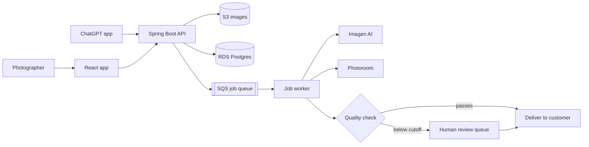

# ShootPro24AI

AI photo and video post-production for photographers and e-commerce sellers.
Live at **[shootpro24ai.com](https://shootpro24ai.com)** and published as an app in ChatGPT.

This repo is a public overview of how ShootPro24AI is built. The production code is private
because it's a commercial product, so the code under `samples/` is simplified to show the main
design patterns. It isn't the full production code.

## What it does

- **AI photo editing** through Imagen AI (profile-based and Smart Editing flows)
- **Product photo services** through Photoroom: cutouts, studio finish, lifestyle scenes, and ghost mannequin
- **Quality check on every AI result**: anything below the cutoff goes to a human editor instead of straight to the customer
- **Human editing** for jobs that need a person
- **ChatGPT app**, so people can use ShootPro24AI as a tool inside ChatGPT

## Tech stack

| Layer | Tech |
|---|---|
| Backend | Java 21, Spring Boot 3 |
| Frontend | React, Vite |
| Hosting | AWS Elastic Beanstalk, CloudFront |
| Data | RDS Postgres, S3 for images and results |
| Auth | Amazon Cognito |
| Jobs | Amazon SQS |
| Email | Amazon SES + SNS for delivery tracking |
| AI providers | Imagen AI, Photoroom, Amazon Rekognition |

## How it works

More detail is in [docs/architecture.md](docs/architecture.md) and [docs/design-decisions.md](docs/design-decisions.md).

## Main design choices

1. **AI jobs run in the background.** Uploads put a job on SQS instead of calling the AI provider
   while the user waits. A slow or failing provider doesn't block the app, and failed jobs can be retried.
2. **Each AI provider sits behind one interface with an on/off flag.** I can turn a provider off,
   rotate its key, or add a new one without touching the rest of the pipeline.
   See [`AiEditProvider`](samples/src/main/java/com/shootpro24ai/showcase/provider/AiEditProvider.java).
3. **AI is the first pass, not the final word.** Every result gets a quality check, and low scores go
   to a person. See [`QualityGate`](samples/src/main/java/com/shootpro24ai/showcase/quality/QualityGate.java).

## Screenshots

See [docs/screenshots](docs/screenshots).

## About me

Biju Jacob, founder and principal engineer at Pycas Design Innovations. Full-stack engineer
(Java/Spring Boot, React, SQL, AWS), AWS Certified Developer and AI Practitioner,
M.S. in Artificial Intelligence in progress at Lewis University.
